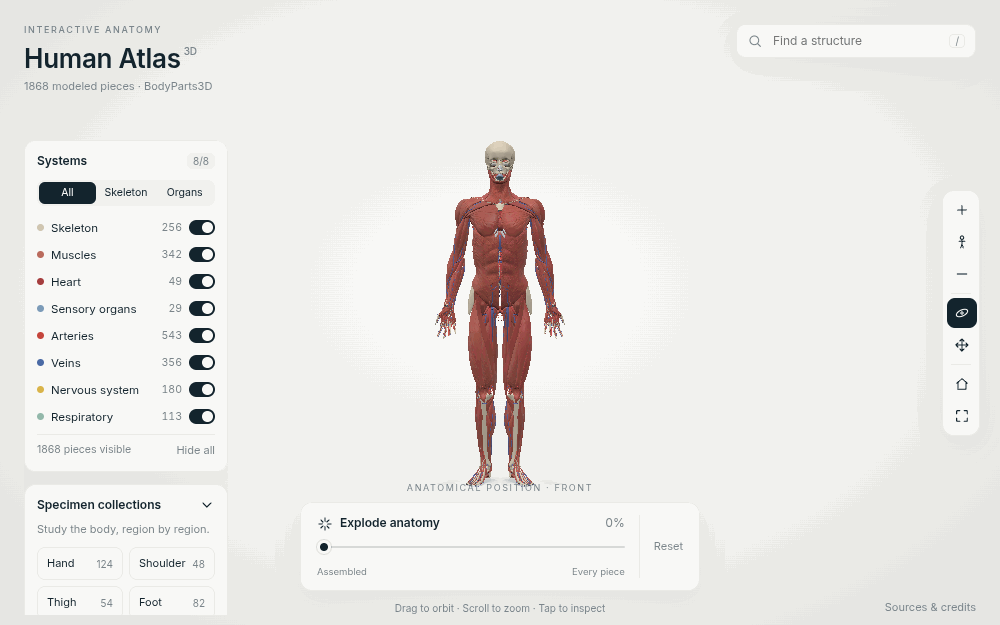

# Human Atlas 3D

**Live demo: _TODO — add your Vercel link after deploying_**

An interactive 3D anatomy explorer that feels like a digital museum. Rotate the body, toggle 8 anatomical systems,
search any of 1,868 real structures, and drag one slider to pull the whole body apart into a catalogued specimen atlas.



_Inspired by TODO — link the original creator/post you remade this from._

## Run it

```bash
npm install
npm run dev
```

The processed anatomy (`public/anatomy`) is committed, so that is all you need.

## Features

- 1,868 labelled meshes from the open BodyParts3D dataset, grouped into 8 systems: skeleton, muscles, heart, sensory organs,
  arteries, veins, nervous system, respiratory
- **Explode slider**: every piece eases from its anatomical position into a specimen sheet (larger pieces on top, smaller ones denser below), and stays clickable
- Hover tooltips, a teal highlight that shows through surrounding tissue, an info panel, and isolate mode
- Search that flies the camera to any structure (`/` to focus)
- Region collections (hand, shoulder, thigh, foot, heart, brain) laid out as specimen sheets, filterable by side
- Keyboard: `F` front view · `I` isolate · `Esc` clear

Stack: React, TypeScript, Vite, three.js via react-three-fiber and drei, Framer Motion, zustand, N8AO ambient occlusion.

## How it works

- **Raycasting.** A ray from the camera through the cursor finds the first visible mesh it hits. Faded pieces are skipped.
- **Interpolation.** Each piece stores an `assembledPosition` and an `explodedPosition`. The slider is one number from 0 to 1, and
  every frame each piece moves to the eased point between the two.
- **Render loop vs React state.** All per-frame animation (positions, fades, highlights) runs in `useFrame` and mutates three.js
  objects directly. React re-renders only on user actions.
- **Camera focus.** A structure's bounding box gives its centre and size. The camera backs off just far enough to fit it
  inside the area the floating panels leave clear, then tweens there.
- **Data pipeline.** `scripts/build-anatomy.ts` turns 2,234 OBJ files named by ID into named, classified, compressed GLBs plus a manifest.

## Rebuilding the anatomy data

1. Download the OBJ archive (`isa_BP3D_4.0_obj_99.zip`) and the `*_element_parts.txt` tables from the
   [BodyParts3D download page](https://dbarchive.biosciencedbc.jp/en/bodyparts3d/download.html), and unzip them into
   `assets/anatomy/raw` (git-ignored).
2. Run `npm run build:anatomy` (needs Node 20+).

The script:
- names each file by its most specific concept;
- classifies it into a system with keyword rules;
- infers left/right for mirrored `FJnnnnM` pairs from position;
- remaps BodyParts3D's Z-up millimetres to Y-up metres;
- lays out the atlas;
- writes one meshopt-compressed GLB per system.

The 366 files it can't classify (mostly organs outside the 8 systems, such as liver or skin) are logged to
`scripts/unclassified.log` rather than guessed.

## What I would do differently

_Draft. Rewrite this in your own words._

I would inspect the dataset before writing the pipeline. BodyParts3D turned out to be Z-up and to list every file under all of
its parent concepts, and those two wrong assumptions silently broke the first build. I would also merge or instance the meshes
per system from the start, because one draw call per piece is the main performance ceiling. Finally, I would add visual checks
for camera framing early: the atlas sliding under the UI panels on smaller laptops was only caught while recording the demo GIF.

## Known gaps

- No instancing or LOD, so there is one draw call per piece.
- Switching between region sheets snaps the old sheet's pieces home instead of animating them.
- BodyParts3D has no verified muscle-attachment data. The info panel lists "nearby" structures and labels them as unverified.

## Credits

BodyParts3D, © The Database Center for Life Science licensed under CC Attribution 4.0 International
([license](https://dbarchive.biosciencedbc.jp/en/bodyparts3d/lic.html)).
